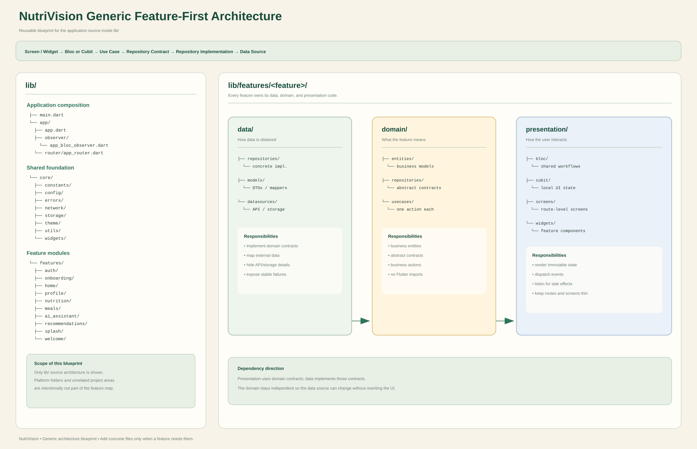

# NutriVision Application Architecture

This document is the implementation guide for the NutriVision Flutter app.
It is written for the project team and for AI coding agents that need to add
features without breaking the existing architecture or visual language.

## 1. Project principles

NutriVision follows these principles:

- Organize code by feature, not by technical type only.
- Keep business rules independent from Flutter and external backends.
- Depend on abstractions in the domain layer, not on concrete data sources.
- Keep screens thin: they compose widgets, render state, and dispatch actions.
- Use one source of truth for data shared by multiple screens.
- Preserve the existing NutriVision visual language: cream backgrounds, dark
  green headers, floating cards and navigation, rounded surfaces, responsive
  sizing, and transparent overlay space around headers and bottom navigation.
- Prefer a small, focused change over a large refactor unrelated to the task.

The canonical repository rules are in [`AGENTS.md`](AGENTS.md). When this file
and `AGENTS.md` appear to disagree, follow `AGENTS.md`.

Reusable project skills and agent task templates are collected in
[`agents/README.md`](agents/README.md).

## 2. Technology stack

- Flutter and Dart
- `flutter_bloc` for feature workflows and local UI state
- `go_router` for centralized navigation
- In-memory repositories as the current backend-independent data layer
- Flutter tests for Bloc/Cubit behavior and critical widgets

No Firebase, API client, database, or other backend should be added unless the
product owner explicitly requests it.

## 3. High-level dependency flow

The dependency direction is one-way:

```text
Screen / Widget
      |
      v
Bloc or Cubit
      |
      v
Use Case
      |
      v
Domain Repository interface
      |
      v
Data Repository implementation
      |
      v
Data source / external service
```

The domain layer must not import Flutter UI packages. Presentation code must
not call repository methods directly, access a backend directly, or contain
business decisions that belong in a use case.

## 4. Feature-first folder structure

Every feature should follow this structure:

```text
lib/features/<feature>/
  data/
    repositories/       # concrete repository implementations
    models/             # optional DTOs/data models when needed
    datasources/        # optional API, local storage, or other data sources
  domain/
    entities/           # business models; no Flutter UI dependencies
    repositories/       # abstract repository contracts
    usecases/           # one business action per use case
  presentation/
    bloc/               # feature-wide workflows: Bloc<Event, State>
    cubit/              # small/local state only
    screens/             # route-level screens
    widgets/             # reusable feature-specific widgets
```

Shared application code belongs outside a feature:

```text
lib/
  app/
    app.dart             # composition root and dependency registration
    router/app_router.dart
    observer/app_bloc_observer.dart
  core/
    constants/           # shared asset names and constants
    theme/               # colors, typography, responsive helpers, system UI
    widgets/             # genuinely reusable cross-feature widgets
  features/
    auth/
    home/
    onboarding/
    profile/
    splash/
    welcome/
  main.dart
```

### Generic `lib/` architecture map

The following image is a reusable blueprint for every NutriVision feature. It
shows only the application source under `lib/`; platform folders, tests,
documentation, assets, and generated files are intentionally excluded.



Do not create a second parallel architecture such as `lib/services/` for
feature business logic or `lib/controllers/` for state that should be a Bloc
or Cubit.

## 5. Layer responsibilities

### Domain

The domain layer defines what the feature does, without knowing how data is
stored or displayed.

- **Entity:** stable business data used by the application.
- **Repository contract:** an abstract class describing required operations.
- **Use case:** one meaningful business action, such as signing in, saving an
  onboarding draft, or loading a dashboard.

Use cases should be small and testable. They may validate business rules, but
they should not show dialogs, navigate, read `BuildContext`, or import Flutter
widgets.

### Data

The data layer implements domain contracts.

- `InMemory...Repository` is the current placeholder implementation.
- Future API, database, Firebase, or local-storage code belongs here.
- Convert external DTOs into domain entities before returning them to the
  presentation layer.
- Do not leak API response models or backend exceptions into widgets.

When replacing an in-memory repository, keep the domain repository interface
stable whenever possible. The feature Bloc and screens should not need to know
which backend is currently active.

### Presentation

Presentation code renders state and translates user interaction into events or
Cubit method calls.

- **Screen:** route-level composition and listeners for one-time side effects.
- **Widget:** reusable visual section belonging to the feature.
- **Bloc:** event-driven feature workflow and async operations.
- **Cubit:** small direct state changes local to a screen or small widget flow.

Widgets should not call repositories or use cases directly.

## 6. Application composition root

`lib/app/app.dart` is the composition root.

It is responsible for:

1. Registering repository abstractions with `MultiRepositoryProvider`.
2. Creating use cases from repositories provided by context.
3. Registering feature state managers with `MultiBlocProvider`.
4. Providing the router and app-wide theme/configuration.

Repositories must not be instantiated repeatedly inside a screen or an
arbitrary `build` method. A screen obtains its Bloc/Cubit through the existing
provider tree.

## 7. Bloc and Cubit policy

Choose the state manager based on the kind of state, not personal preference.

### Use `Bloc<Event, State>` when

- the flow spans multiple screens;
- there are multiple user actions/events;
- work is asynchronous;
- loading, success, and failure must be modeled;
- state is shared by more than one widget or screen;
- navigation or other side effects depend on a workflow result.

Current examples include:

- `AuthSessionBloc` for sign in, sign up, and sign out;
- `OnboardingBloc` for goals, dietary preferences, favorite foods,
  allergies, draft saving, reset, and completion;
- `HomeBloc` for dashboard loading and tab selection.

### Use `Cubit<State>` when

- the state is local and direct;
- there is no meaningful event history or multi-step workflow;
- the state does not need to be shared across unrelated screens.

Current examples include `SignInCubit` and `SignUpCubit` for password
visibility and terms selection.

### State rules

- Keep states immutable.
- Use `copyWith` or new state instances for updates.
- Model async states explicitly: initial, loading, success/data, and failure.
- Keep business decisions in use cases/domain code when appropriate.
- Use `BlocBuilder` for rendering.
- Use `BlocListener` or `BlocConsumer` for navigation, `AppToast`, and other
  one-time side effects.
- Do not put navigation calls in a repository or entity.
- Do not create duplicate local copies of shared onboarding or session data.

## 8. Navigation and authentication flow

Navigation is centralized in:

```text
lib/app/router/app_router.dart
```

Use the existing named routes and route paths. Do not create ad-hoc route
instances inside feature widgets.

Authentication and onboarding transitions should be driven by Bloc state and
listeners. Do not add hidden global flags or direct repository checks inside a
screen. Preserve the current temporary behavior where account creation opens
onboarding until the product owner requests a different flow.

## 9. UI and design system rules

Reuse the shared tokens and helpers before adding new values:

- `AppColors`
- `AppResponsive.value`
- `AppResponsive.font`
- `AppTheme`
- `AppSystemUi`
- shared widgets in `lib/core/widgets/`

For screens whose header overlays scrollable content, use
`AppOverlayScaffold`. Keep the established transparent space around headers and
allow content to scroll behind the header where that is the current design.

Keep the home header, nutrition card, and bottom navigation floating/overlaid.
Feature-specific cards and sections belong in that feature's
`presentation/widgets/` directory. Do not move feature UI into `core` merely to
avoid creating a feature widget file.

Accessibility is part of the UI contract:

- use meaningful labels and semantic controls;
- keep readable contrast and reasonable tap targets;
- do not communicate important information through color alone;
- use responsive helpers instead of scattering device-specific constants.

## 10. User feedback

Use `AppToast` from `lib/core/widgets/app_toast.dart` for in-app notifications.
Never introduce a raw `SnackBar` or a feature-specific toast.

Show a toast when the user needs short-lived contextual feedback, for example:

- a meaningful async success or failure;
- a validation blocker;
- an unavailable action.

Do not show a toast merely because a screen opened, a normal selection changed,
or visible UI already communicates the state. Use `success`, `error`,
`warning`, or `info` according to the situation.

## 11. How to add a new feature

Follow this sequence for a new feature such as meal history, meal scanning, or
recipe suggestions:

1. Define the feature's domain entities and repository contract.
2. Add one use case per business action.
3. Add an in-memory repository implementation first unless a real backend is
   explicitly required.
4. Decide whether the workflow needs a Bloc or only local Cubit state.
5. Create immutable states and events/methods for the required actions.
6. Register the repository, use cases, and state manager in `lib/app/app.dart`.
7. Add route-level screens under `presentation/screens/`.
8. Extract reusable feature sections into `presentation/widgets/`.
9. Add or update named routes in `lib/app/router/app_router.dart`.
10. Add `BlocListener`/`BlocConsumer` only where navigation or user feedback
    is required.
11. Add Bloc/Cubit tests for state transitions and widget tests for important
    UI/navigation behavior.
12. Run the verification commands before handing the work to the team.

## 12. Example feature skeleton

```text
lib/features/meal_history/
  data/
    repositories/
      in_memory_meal_history_repository.dart
  domain/
    entities/
      meal_record.dart
    repositories/
      meal_history_repository.dart
    usecases/
      get_meal_history.dart
      delete_meal_record.dart
  presentation/
    bloc/
      meal_history_bloc.dart
    screens/
      meal_history_screen.dart
    widgets/
      meal_history_card.dart
```

The screen dispatches an event such as `LoadMealHistory`; the Bloc calls the
`GetMealHistory` use case; the use case calls the domain repository contract;
and the injected data repository supplies the data.

## 13. Testing and verification

Before opening a pull request or handing work to another agent, run:

```bash
dart format .
flutter analyze
flutter test
```

Tests should verify observable behavior:

- dispatch Bloc events and assert resulting states;
- test use cases and repository behavior through public methods;
- add widget tests for changed screens, navigation, and shared widgets;
- avoid testing private implementation details.

Also confirm that:

- no old imports or unused state managers remain;
- meaningful success, failure, validation, and unavailable-action paths have
  appropriate feedback;
- no generated files, build output, secrets, credentials, or personal IDE
  settings were added;
- unrelated working-tree changes were preserved;
- the visual behavior of existing screens was not unintentionally changed.

## 14. AI agent handoff checklist

An agent receiving a NutriVision task should:

1. Read `AGENTS.md` and this file before editing.
2. Inspect the relevant feature, router, composition root, and tests.
3. Check `git status` and preserve unrelated user changes.
4. Identify whether the requested state is local UI state or a shared workflow.
5. Keep repository access behind use cases and domain contracts.
6. Reuse existing theme tokens, responsive helpers, shared widgets, and
   `AppToast` behavior.
7. Make the smallest focused change that satisfies the request.
8. Run formatting, analysis, and tests.
9. Report changed files, verification results, and any remaining limitation.

A useful task prompt for another agent is:

```text
Read AGENTS.md and ARCHITECTURE.md first. Work only inside the requested
feature. Preserve existing user changes. Follow the feature-first Clean
Architecture, use Bloc for shared/async workflows and Cubit only for local
state, register dependencies in lib/app/app.dart, use named routes, reuse
NutriVision theme helpers, and run dart format ., flutter analyze, and flutter
test before reporting completion.
```
